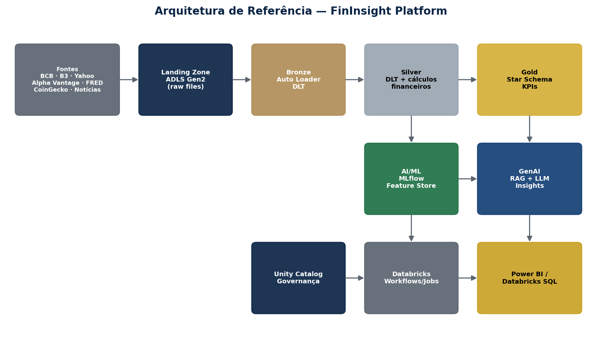
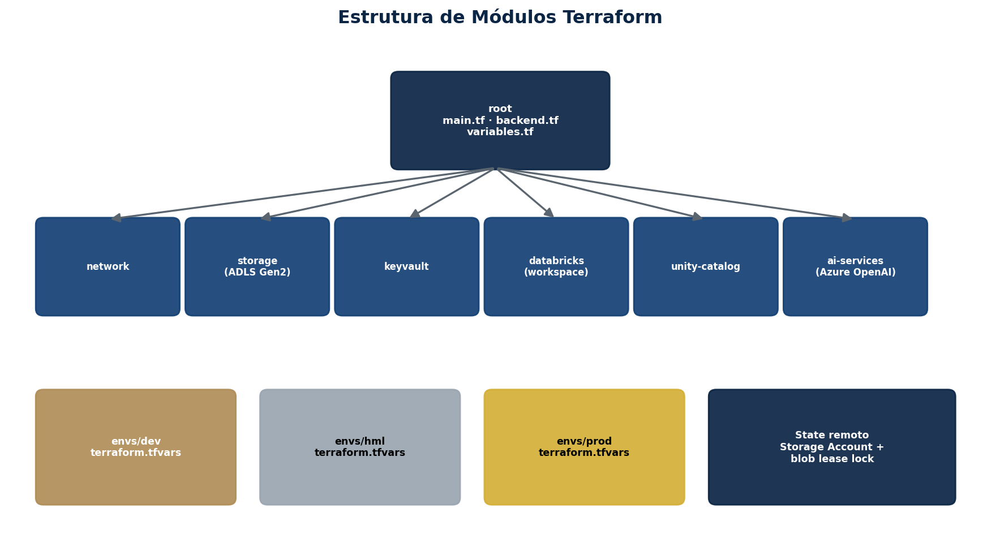
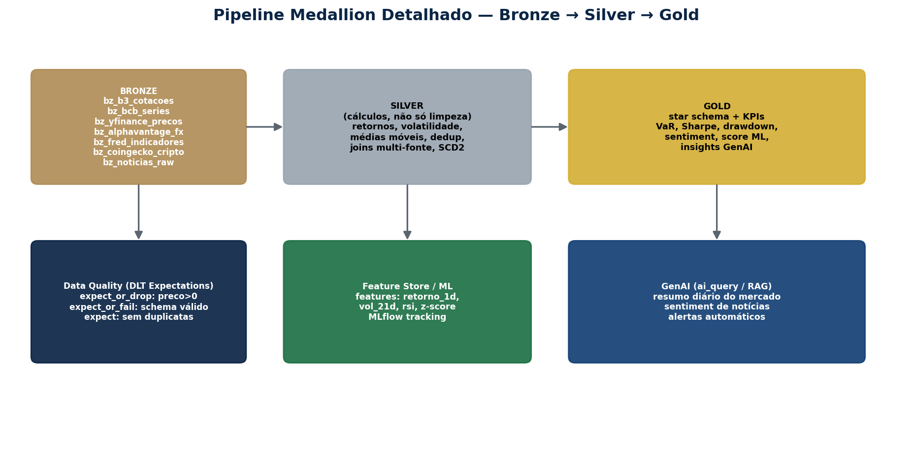
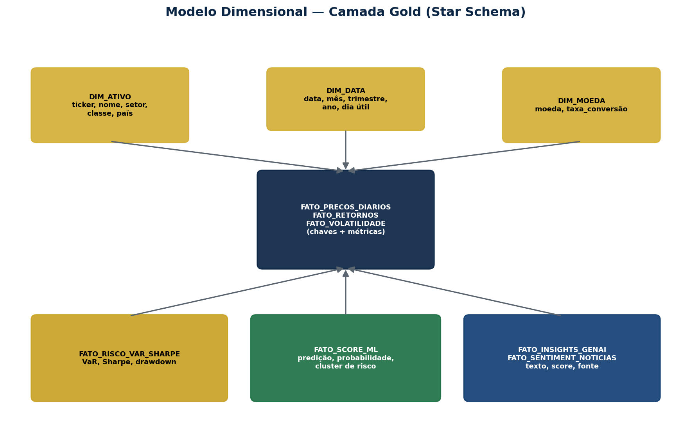

# FinInsight Platform

Financial market data platform on Azure + Databricks — Medallion Architecture (Bronze/Silver/Gold), AI/ML and GenAI, provisioned with Terraform.

> Study project for the **Databricks Certified Data Engineer Associate** certification, focused on real-world data engineering applied to financial markets.

**Documentation v3.0** — restructured into **sprints** (each part ends with something running and a checkpoint), using the **new pipelines API** (`from pyspark import pipelines as dp`), COPY INTO, Streaming Tables with `SCHEDULE`/`REFRESH`, Declarative Pipelines and a comparison of the ingestion options. The handbook has **43 chapters** (written in Portuguese).

## Table of Contents

- [Overview](#overview)
- [Architecture](#architecture)
- [What's new in v3.0](#whats-new-in-v30)
- [Execution order (sprints)](#execution-order-sprints)
- [Repository structure](#repository-structure)
- [Prerequisites](#prerequisites)
- [Provisioning the infrastructure (Terraform)](#provisioning-the-infrastructure-terraform)
- [Verifying in the Azure Portal](#verifying-in-the-azure-portal)
- [Ingestion: four options and when to use each](#ingestion-four-options-and-when-to-use-each)
- [Data pipelines](#data-pipelines)
- [Table catalog](#table-catalog)
- [AI/ML](#aiml)
- [GenAI](#genai)
- [CI/CD](#cicd)
- [Environments](#environments)
- [Costs](#costs)
- [Validation status](#validation-status)
- [Full documentation](#full-documentation)

## Overview

FinInsight Capital (a fictional company) consolidates free, public financial market data
(BCB, B3, Yahoo Finance, Alpha Vantage, FRED, CoinGecko and news) into a Databricks Lakehouse,
computes risk/return KPIs (VaR, Sharpe, volatility, drawdown), trains predictive models, and
generates automated natural-language insights via GenAI.

## Architecture

```
Sources → Landing (Volume on ADLS Gen2) → Bronze (Auto Loader / COPY INTO / Streaming Table / Event Hubs)
        → Silver (financial calculations) → Gold (star schema + KPIs)
        → AI/ML (MLflow) + GenAI (ai_query / Vector Search) → Power BI / Databricks SQL
```



Full details, with diagrams, are in the handbook at `docs/Apostila_FinInsight_Databricks_Azure.pdf`.

## What's new in v3.0

| Topic | What changed | Ch. |
|---|---|---|
| Structure | **Incremental sprint order**; every sprint ends with a checkpoint | 1 |
| Pipelines API | `from pyspark import pipelines as dp` (`@dp.table`, `@dp.materialized_view`, `dp.create_auto_cdc_flow`); reads with `spark.read.table("name")` | 16 |
| Minimal infra | `main.tf` has only storage, databricks and unity-catalog active; `eventhubs`, `keyvault` and `ai_services` are **commented out** until needed | 7, 23, 41 |
| Secrets | Notebook 00 **creates the scope** `fininsight`; Terraform only adds the Event Hubs secrets | 14, 23 |
| Bronze | First `bz_bcb_series.py` running, then the other six; `bz_cotacoes_streaming.py` only with Event Hubs | 17, 23 |
| Ingestion | COPY INTO, Streaming Tables with `SCHEDULE`, SQL pipeline and a comparison | 19–22 |
| Silver/Gold | One pipeline per layer; Silver/Gold as materialized views; Selic in % per day fixed | 25–33 |
| MLflow | Unity Catalog registry with `champion` alias | 35–36 |
| Restart | Step-by-step cleanup of the old project before deleting it (destroy, purge, state) | 1 |
| Troubleshooting | Table with every real error and its fix | 42 |

## Execution order (sprints)

| Sprint | Deliverable | Chs. |
|---|---|---|
| 1 — Minimal infra | Storage, Databricks workspace and Unity Catalog with landing/volume | 6–12 |
| 2 — First data | Git folder, secrets, API collection and Bronze pipeline (7 sources) | 13–17 |
| 3 — Ingestion | Schema evolution, COPY INTO, Streaming Table, SQL pipeline, comparison, Event Hubs | 18–23 |
| 4 — Silver | Delta, financial calculations, join, SCD2, quality | 24–29 |
| 5 — Gold | Star schema and risk KPIs | 30–33 |
| 6 — AI/ML and GenAI | Features, models, scoring, insights, RAG | 34–37 |
| Operations | Job + bundle, CI/CD, governance, optional modules, troubleshooting | 38–43 |

## Repository structure

```
fininsight-platform/
├── README.md
├── README_en.md
├── databricks.yml                       # Asset Bundle: pipelines + daily job (ch. 38)
├── bitbucket-pipelines.yml              # CI/CD DEV → HML → PROD (ch. 39)
├── .github/workflows/deploy.yml         # GitHub Actions equivalent
├── docs/
│   ├── Apostila_FinInsight_Databricks_Azure.pdf
│   └── diagramas/
│       ├── d_arquitetura.png
│       ├── d_medallion.png
│       ├── d_starschema.png
│       └── d_terraform.png
├── infra/                               # Terraform (IaC) — Part II
│   ├── main.tf
│   ├── backend.tf
│   ├── variables.tf
│   ├── outputs.tf
│   ├── envs/
│   │   ├── dev/terraform.tfvars
│   │   ├── hml/terraform.tfvars
│   │   └── prod/terraform.tfvars
│   └── modules/                         # main.tf: storage/databricks/unity-catalog active; others commented out
│       ├── storage/                     # ADLS Gen2 (landing/bronze/silver/gold/unitycatalog)
│       ├── keyvault/
│       ├── network/                     # reserved
│       ├── databricks/                  # Workspace + Access Connector + roles
│       ├── unity-catalog/               # credential, external locations, catalog, schemas, landing volume
│       ├── ai-services/                 # Azure OpenAI (optional)
│       └── eventhubs/                   # Event Hubs (Kafka) + secret scope   [NEW]
├── notebooks/                           # run in Databricks
│   ├── 00_configurar_secrets.py         # creates the fininsight scope and stores API keys
│   ├── 01_coleta_apis.py                # collects the 7 sources into landing
│   ├── 02_streaming_producer.py         # quote producer (Event Hubs)
│   ├── 04_feature_engineering.py
│   ├── 05_batch_scoring.py
│   └── 06_genai_insights.py
├── pipelines/                           # Lakeflow Spark Declarative Pipelines (ex-DLT), `dp` API
│   ├── bronze/                          # pipeline fininsight_bronze
│   │   ├── bz_b3_cotacoes.py
│   │   ├── bz_bcb_series.py
│   │   ├── bz_yfinance_precos.py
│   │   ├── bz_alphavantage_fx.py
│   │   ├── bz_fred_indicadores.py
│   │   ├── bz_coingecko_cripto.py
│   │   ├── bz_noticias_raw.py
│   │   └── bz_cotacoes_streaming.py     # Kafka / Event Hubs
│   ├── bronze_sql/
│   │   └── bz_b3_cotacoes_pipeline.sql  # SQL pipeline variant   [NEW]
│   ├── silver/                          # pipeline fininsight_silver
│   │   ├── sv_precos_ativos.py
│   │   ├── sv_retornos_volatilidade.py  # log return, SMA, vol, RSI, z-score
│   │   ├── sv_precos_com_macro.py       # price + USD + Selic join
│   │   ├── sv_indicadores_macro.py
│   │   ├── sv_cambio.py
│   │   ├── sv_cripto.py
│   │   ├── sv_noticias_processadas.py
│   │   └── sv_carteiras_scd2.py         # APPLY CHANGES (SCD2)
│   └── gold/                            # pipeline fininsight_gold
│       ├── dim_ativo.py
│       ├── dim_data.py
│       ├── dim_moeda.py
│       ├── fato_precos_diarios.py
│       ├── fato_retornos.py
│       ├── fato_volatilidade.py
│       ├── fato_risco_var_sharpe.py     # VaR, Sharpe, drawdown
│       └── fato_sentiment_noticias.py   # AI Functions
├── sql/                                 # SQL Editor
│   ├── 01_copy_into_b3.sql              # COPY INTO                       [NEW]
│   ├── 02_streaming_table_b3.sql        # Streaming Table + SCHEDULE      [NEW]
│   ├── 03_streaming_table_operacao.sql  # REFRESH / ALTER / DROP SCHEDULE [NEW]
│   ├── 04_seed_carteiras_cdc.sql        # CDC events (SCD2)
│   ├── 05_delta_lake_demo.sql
│   ├── 06_event_log_qualidade.sql
│   ├── 07_governanca.sql
│   └── 08_vw_dashboard_executivo.sql
├── ml/
│   ├── classificador_risco.py
│   ├── previsao_series_temporais.py
│   ├── clusterizacao_ativos.py
│   └── promover_modelo.py
├── genai/
│   └── vector_search_setup.py
└── tests/
    └── test_formulas_financeiras.py     # pandas reference for the formulas
```

## Prerequisites

- Azure account with Owner/Contributor permission on the Resource Group(s)
- Terraform >= 1.7, Azure CLI and VS Code
- An active Azure subscription (a brand-new account works: providers are registered in step 1). The **Unity Catalog metastore** is created and attached automatically by Azure when the first workspace in the region is created; there is no ID to copy
- Databricks CLI (`databricks bundle` — Asset Bundles), for chapter 38
- Python 3.10+ (local tests) and a GitHub repository (Git folder in Databricks)
- Free API keys: Alpha Vantage, FRED and NewsAPI (the free tier of some endpoints may be limited)



## Provisioning the infrastructure (Terraform)

1. Sign in to the right account and register the providers (a new account starts without them):

```bash
az login --use-device-code --tenant YOUR_TENANT_ID
az account set --subscription YOUR_SUBSCRIPTION_ID
az account show --query "{user:user.name, subscription:name}" -o json
az provider register --namespace Microsoft.Storage --wait
az provider register --namespace Microsoft.Databricks --wait
az provider register --namespace Microsoft.Authorization
az provider register --namespace Microsoft.KeyVault
az provider register --namespace Microsoft.CognitiveServices
az provider register --namespace Microsoft.EventHub
az provider register --namespace Microsoft.EventGrid
```

2. Create the state storage (once), one line per command (PowerShell does not accept `\`). The Storage Account name is globally unique; if `002` is taken, change the number and update `infra/backend.tf`:

```bash
az group create -n rg-tfstate-fininsight -l eastus2
az storage account create -n tfstatefininsight002 -g rg-tfstate-fininsight -l eastus2 --sku Standard_LRS --encryption-services blob
az role assignment create --assignee $(az ad signed-in-user show --query id -o tsv) --role "Storage Blob Data Contributor" --scope $(az group show -n rg-tfstate-fininsight --query id -o tsv)
az storage container create -n tfstate --account-name tfstatefininsight002 --auth-mode login
```

In PowerShell, store the results in variables (`$me = az ad signed-in-user show --query id -o tsv` and `$rg = az group show -n rg-tfstate-fininsight --query id -o tsv`) and use `--assignee $me --scope $rg`. The role can take 1-2 minutes to take effect: if `container create` returns 403, wait and retry.

3. Apply in **two phases** (only storage, databricks and unity-catalog are active in `main.tf`). There is no `metastore_id` to fill in: the new workspace is already attached to the region's metastore.

```bash
cd infra
terraform init -reconfigure
terraform validate
terraform apply -var-file="envs/dev/terraform.tfvars" -target=module.databricks
```

Check in *Launch Workspace > Catalog* that the workspace has a metastore attached. Then apply the rest (Unity Catalog, catalog, schemas, volume):

```bash
terraform plan -var-file="envs/dev/terraform.tfvars" -out=plan.out
terraform apply plan.out
```

For another environment: `terraform init -reconfigure -backend-config="key=fininsight.hml.tfstate"` and the `hml`/`prod` tfvars.
Never point two environments at the same Storage Account/catalog.

## Verifying in the Azure Portal

After `apply`, confirm manually (full step-by-step in Chapter 11 of the handbook):

1. Resource Group (storage, workspace and Access Connector) → 5 containers (landing/bronze/silver/gold/unitycatalog) in the Storage Account.
2. Access Connector → Identity → copy the Object ID.
3. IAM on the Storage Account → `Storage Blob/Queue Data Contributor` assigned.
4. IAM on the Resource Group → `EventGrid EventSubscription Contributor` and `Storage Account Contributor`.
5. Databricks Catalog Explorer → External Locations → **Test connection** (all green) for bronze, landing and catalog-root.
6. Catalog Explorer → `fininsight_dev` catalog with bronze/silver/gold/landing schemas and the `landing.raw` volume.

## Ingestion: four options and when to use each

The same B3 files reach Bronze through four paths, kept side by side for comparison (Chapters 18–23):

| Table | Created with | Scheduling | When to use |
|---|---|---|---|
| `bz_b3_cotacoes` | **Auto Loader** in a Python pipeline | Pipeline / Job | Bronze→Silver→Gold flow with quality and lineage (**the official one**) |
| `bz_b3_cotacoes_copyinto` | **COPY INTO** (SQL) | You schedule it (Job/notebook) | One-off or low-volume loads in plain SQL |
| `bz_b3_cotacoes_sql` | **Standalone Streaming Table** | `SCHEDULE EVERY n HOUR/DAY/WEEK` or `SCHEDULE CRON ...` | A single isolated table that refreshes itself |
| `bz_b3_cotacoes_pipe` | **Streaming Table in a SQL pipeline** | Pipeline / Job | SQL teams that need a dependency graph |

Day-to-day operations on a scheduled Streaming Table:

```sql
REFRESH STREAMING TABLE fininsight_dev.bronze.bz_b3_cotacoes_sql;            -- refresh now
REFRESH STREAMING TABLE fininsight_dev.bronze.bz_b3_cotacoes_sql FULL;       -- reprocess everything
ALTER STREAMING TABLE fininsight_dev.bronze.bz_b3_cotacoes_sql ALTER SCHEDULE EVERY 1 DAY;
ALTER STREAMING TABLE fininsight_dev.bronze.bz_b3_cotacoes_sql DROP SCHEDULE;
```

> `SCHEDULE` only applies to **standalone** streaming tables. For tables that belong to a pipeline, scheduling is done on the pipeline or in a Job.

## Data pipelines

One pipeline per layer (`fininsight_bronze`, `fininsight_silver`, `fininsight_gold`), all serverless, chained by a Job (`databricks.yml`):

```bash
databricks bundle validate -t dev
databricks bundle deploy -t dev
databricks bundle run fininsight_job_diario -t dev
```

The Silver layer performs **full financial calculations**: logarithmic return, moving averages (SMA 21d/63d), annualized volatility, 14-day RSI, z-score and multi-source joins (price + USD + Selic). For complete windows, run the 2-year *backfill* (`PERIODO_YF = "2y"` in notebook 01). See Chapters 25–33.



## Table catalog

**26 tables** in the model: 8 Bronze (7 file sources + 1 streaming), 8 Silver and 10 Gold (3 dimensions + 7 facts), plus 4 demonstration tables (COPY INTO, Streaming Table, SQL pipeline and CDC seed). The original design said 23; the implementation ended up with 26. Full list and star schema in Chapter 30.



## AI/ML

- Feature table in Unity Catalog (`fininsight_dev.ml.features_ativos`) derived from Silver
- Models: risk classifier (Gradient Boosting), USD forecast (Prophet), asset clustering (KMeans)
- Tracking and Registry in **Unity Catalog** with a `champion` alias; batch scoring writes `gold.fato_score_ml`

## GenAI

- Daily insights via `ai_query` (Foundation Model API) stored in `gold.fato_insights_genai`
- News summarization and sentiment via `ai_summarize` / `ai_classify`
- RAG over news with Databricks Vector Search; optional Azure OpenAI (Terraform module)

## CI/CD

Per-branch deployment with Asset Bundles: `develop` → DEV, `release/*` → HML, `main` → PROD (manual, with mandatory PR review).
Files for Bitbucket Pipelines and GitHub Actions are included, authenticating with a service principal.

## Environments

| Environment | Unity Catalog catalog | Purpose |
|---|---|---|
| DEV | `fininsight_dev` | Development and testing |
| HML | `fininsight_hml` | Staging / business validation |
| PROD | `fininsight_prod` | Production |

`tfvars` changes the **infrastructure** per environment; `databricks.yml` changes the **host and catalog** of the code deployment (Chapter 12).

## Costs

| Resource | When it bills | How to control |
|---|---|---|
| Event Hubs Standard | Hourly, while the namespace exists | `terraform destroy -target=module.eventhubs` |
| Serverless pipelines and Streaming Tables with `SCHEDULE` | Per refresh | Development mode, `DROP SCHEDULE`, run on demand |
| Daily job | Each run | Keep `PAUSED` while studying |
| AI Functions / Azure OpenAI | Per token | Few rows; avoid continuous pipelines |
| Vector Search | Hourly per endpoint | Delete when done |

## Validation status

- **Executed** (with the old `import dlt` API): Terraform (storage, keyvault, databricks, unity-catalog, ai-services), notebooks 01/02 and the 8 Bronze files. In this version the code was converted to the `dp` API with the same logic.
- **Written from the documentation, not yet executed**: notebook 00 (creates the scope), COPY INTO, Streaming Table with `SCHEDULE`, SQL pipeline, the `eventhubs` module, landing/volume in Terraform, Silver and Gold (formulas covered by a pandas reference test).
- **Reference code**: ML, GenAI, Vector Search, bundle and CI/CD — they depend on data history, permissions and endpoints in your workspace.

## Full documentation

The detailed step-by-step (43 chapters: infrastructure, ingestion, pipelines, modeling, AI/ML, GenAI, governance and
troubleshooting with every real error) is in **`docs/Apostila_FinInsight_Databricks_Azure.pdf`** (Portuguese), with a clickable
table of contents and bookmarks per chapter.
